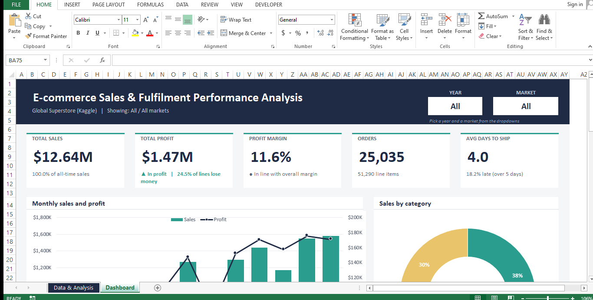

# E-commerce Sales & Fulfilment Performance Analysis (Excel)

An Excel project that turns 51,290 raw e-commerce order lines into a clean data model, formula-driven calculation blocks and a one-page interactive dashboard. It answers four business questions about profit, discounting, delivery speed and trend, and every number on the dashboard traces back to a formula.



## Results at a Glance
| Measure | Value |
|---|---|
| Total sales | $12.64M |
| Total profit | $1.47M |
| Profit margin | 11.6% |
| Orders (unique Order IDs) | 25,035 |
| Order lines | 51,290 |
| Average days to ship | 4.0 |
| Late deliveries (over 5 days) | 18.2% |
| Loss-making order lines | 24.5% (12,544) |
| Period | January 2011 to December 2014 |

**The headline:** discounts above 30% are the single biggest profit leak. They touch 20% of order lines and 12% of sales, yet they lost $793.5K. Every other discount band combined earned about $2.26M.

## Table of Contents
1. [Business Questions](#business-questions)
2. [Dataset](#dataset)
3. [Tools and Skills](#tools-and-skills)
4. [Workbook Structure](#workbook-structure)
5. [Data Cleaning](#data-cleaning)
6. [Calculated Columns](#calculated-columns)
7. [How the Dashboard Works](#how-the-dashboard-works)
8. [Key Formulas](#key-formulas)
9. [Validation and Reconciliation](#validation-and-reconciliation)
10. [Dashboard Guide](#dashboard-guide)
11. [Key Findings](#key-findings)
12. [Recommendations](#recommendations)
13. [Limitations](#limitations)
14. [How to Use](#how-to-use)
15. [Repository Contents](#repository-contents)
16. [Author](#author)

## Business Questions
1. Which categories, regions and markets drive profit, and which lose money?
2. How does discounting affect profit margin?
3. How fast are orders shipped, and which ship modes are slowest?
4. How did sales and profit trend over time?

## Dataset
- **Source:** Global Superstore (Kaggle), `Global_Superstore2.csv`
- **Size:** 51,290 order lines, 24 original fields, 1 January 2011 to 31 December 2014
- **Grain:** one row per product line within an order. One order can span several rows, so the 51,290 lines make up 25,035 orders (about 2 lines per order)
- **Scope:** 7 markets, 13 regions, 3 categories, 17 sub-categories, 4 ship modes, 3 customer segments
- **Key fields:** Order Date, Ship Date, Ship Mode, Order Priority, Market, Region, Category, Sub-Category, Sales, Quantity, Discount, Profit, Shipping Cost

## Tools and Skills
Excel 2013 and later, with no macros, no Power Query and no dynamic-array functions, so it opens the same way on any version.

- Excel Tables and structured references
- SUMIFS, COUNTIFS, AVERAGEIFS
- INDEX-MATCH lookups and LARGE for ranking
- IFERROR, TEXT, date functions
- Named ranges, data validation dropdowns, conditional formatting
- Pivot table (used as an independent control total)
- Combo, doughnut, column and bar charts; dashboard layout on a fixed grid

## Workbook Structure
**Sheet 1: Data & Analysis** (everything data-related, in four zones left to right)

| Zone | Starts at | What it holds |
|---|---|---|
| A | Column A | Cleaned order table `tblOrders` (columns A to X) plus ten calculated columns (Y to AH) |
| B | Column AJ | Parameters (late-delivery threshold, dropdown selections, data source label), discount band table, lookup lists |
| C | Column BG | Calculation blocks: KPIs, monthly trend, category, sub-category, market, region, ship mode, discount band, yearly, top 10, insight inputs |
| D | Column DM | Data quality log and reconciliation checks |

**Sheet 2: Dashboard** (presentation only, no raw data)
Year and Market dropdowns, 5 KPI tiles, 7 charts and a text panel that rewrites itself when the selection changes.

## Data Cleaning
| Step | Result |
|---|---|
| Rows in raw file | 51,290 |
| Text dates converted to real dates (Order Date and Ship Date) | 102,580 cells |
| Exact duplicate rows removed (identical on every field except Row ID) | 0 |
| Rows sharing Order ID + Product ID | 38, kept (see note below) |
| Rows after cleaning | 51,290 |
| Blank Order Date, Ship Date, Sales or Quantity | 0 |
| Ship Date earlier than Order Date | 0 |
| Zero or negative Quantity | 0 |
| Blank Postal Code | 41,296, left as is (the field is only filled for US orders) |
| Loss-making order lines | 12,544, kept and shown in coral on the dashboard |

**Decision on duplicates:** 38 rows repeat an Order ID + Product ID pair. On inspection they are not true duplicates. Each pair differs in quantity, sales and shipping cost, for example a 6-unit line and a 9-unit line of the same product in one order. Removing them would delete about $9.2K of genuine sales, so they were kept and logged instead.

Other steps:
- Trimmed extra spaces in text fields
- Sorted the table by Order ID so unique orders can be counted with a flag column
- Added dropdown validation to Ship Mode, Segment and Market

## Calculated Columns
| Column | Purpose |
|---|---|
| Order Year | Year of Order Date, used by the Year filter |
| Order Month | First day of the order month |
| Month No | 1 to 12, used for the calendar-month trend |
| Days to Ship | Ship Date minus Order Date |
| Late Flag | 1 when Days to Ship is above the threshold in Zone B (set to 5 days) |
| Profit Margin % | Profit divided by Sales |
| Loss Flag | 1 when Profit is negative |
| Discount Band | No discount, 1-10%, 11-20%, 21-30%, Over 30% |
| New Order Flag | 1 on the first row of each Order ID, so orders are counted once |
| Date Issue | 1 when a date is blank, not a date, or Ship Date is before Order Date |

## How the Dashboard Works
1. The Year and Market dropdowns live in the Dashboard banner.
2. Zone B reads them and turns them into filter criteria. "All" becomes a wildcard for Market and a 0 to 9999 range for Year.
3. Every block in Zone C applies those criteria with SUMIFS, COUNTIFS or AVERAGEIFS.
4. Charts, KPI tiles and insight sentences on the Dashboard point at Zone C. Nothing on the Dashboard is typed in or pasted.

Two charts ignore one filter on purpose. Profit by market ignores the Market dropdown and the yearly chart ignores the Year dropdown, otherwise each would collapse to a single bar.

## Key Formulas
Filtered total (the pattern used across Zone C):
```
=SUMIFS(col_Sales, col_Year, ">="&YearFrom, col_Year, "<="&YearTo, col_Market, MktCrit)
```
Unique orders (table sorted by Order ID, so a change in ID marks a new order):
```
=IF(ROW()=2, 1, IF(tblOrders[[#This Row],[Order ID]]=INDEX(tblOrders[Order ID], ROW()-2), 0, 1))
```
Average days to ship, excluding rows with date problems:
```
=IFERROR(AVERAGEIFS(col_Days, <filters>, col_DateIssue, 0), 0)
```
Discount band lookup:
```
=INDEX(band_labels, MATCH([@Discount], band_starts, 1))
```
Top 10 sub-categories, with a tiny tie-breaker so equal profits do not break the ranking:
```
Rank key:  =Profit + ROW()/10^9
Name:      =INDEX(names, MATCH(LARGE(rank_keys, k), rank_keys, 0))
```
Dynamic insight text:
```
=Category & " leads on profit at " & TEXT(margin, "0.0%") & " margin"
```

## Validation and Reconciliation
Zone D contains:
- A data quality log (the table in the Data Cleaning section above)
- A row count check: raw rows minus duplicates equals rows after cleaning (OK)
- A control check comparing the raw column totals with the sum of the category SUMIFS totals (OK)
- A pivot table reconciliation: pivot totals by category sit next to the SUMIFS totals and the sheet shows OK or CHECK

Expected category totals, which the pivot table must match:

| Category | Sales | Profit |
|---|---|---|
| Technology | 4,744,557.50 | 663,778.73 |
| Furniture | 4,110,874.19 | 285,204.72 |
| Office Supplies | 3,787,070.23 | 518,473.83 |
| Total | 12,642,501.91 | 1,467,457.29 |

The workbook totals were also checked against an independent pandas calculation on the raw CSV and matched to the cent.

## Dashboard Guide
| Section | What it shows |
|---|---|
| KPI tiles | Total sales, total profit, profit margin %, orders, average days to ship. Sub-text compares margin with the overall margin and shows the late-delivery rate |
| Monthly sales and profit | Calendar-month columns for sales with a profit line on a second axis |
| Sales by category | Doughnut of category share |
| Profit by market | Columns per market, losses in coral |
| Days to ship by ship mode | Average delivery time per mode |
| Margin by discount band | Sales-weighted margin per band, negatives in coral |
| Top 10 sub-categories | Horizontal bars ranked by profit |
| Sales and profit by year | Yearly comparison |
| Insights | Five sentences that update with the dropdowns |

Colours: navy `#1F2A44` banner, teal `#2A9D8F` main series, amber `#E9C46A` highlights, coral `#E76F51` losses and warnings.

## Key Findings

### 1. Technology earns the most profit, Furniture the least per dollar
| Category | Sales | Profit | Margin |
|---|---|---|---|
| Technology | $4.74M | $664K | 14.0% |
| Office Supplies | $3.79M | $518K | 13.7% |
| Furniture | $4.11M | $285K | 6.9% |

Technology produces 45% of profit from 37.5% of sales. Furniture brings in almost as much revenue as Technology but keeps less than half the margin. Copiers ($259K) and Phones ($217K) are the two most profitable sub-categories, and the top three sub-categories (Copiers, Phones, Bookcases) deliver 43% of all profit.

### 2. Tables is the only sub-category that loses money
Tables lost $64.1K on $757K of sales, a margin of -8.5%. The cause is discounting. Tables sold at discounts of 20% or less earned $68.5K, while the 351 Table lines discounted over 30% lost $120.6K on their own. Tables lose money in every large market: EU (-$21.0K), APAC (-$20.1K), US (-$17.7K) and LATAM (-$12.3K). Machines (7.6%), Supplies (9.3%), Chairs (9.3%) and Storage (9.6%) have the thinnest positive margins.

### 3. Discounts above 30% destroy profit
| Discount band | Order lines | Margin |
|---|---|---|
| No discount | 29,009 | 25.3% |
| 1-10% | 4,679 | 17.2% |
| 11-20% | 6,274 | 9.9% |
| 21-30% | 967 | -5.5% |
| Over 30% | 10,361 | -51.3% |

Margin falls steadily as discounts deepen and turns negative above 20%. The 10,361 lines discounted over 30% are 20% of all lines and 12% of sales, and they lost $793.5K. About 76% of all loss-making lines carry a discount over 30%, and 89% carry a discount of 20% or more. The 43% of lines that get any discount are where nearly all the leakage sits.

### 4. Three markets generate three quarters of profit
APAC ($436K), EU ($373K) and the US ($286K) deliver 75% of profit from 70% of sales. Margins are close across them (12.2% to 12.7%).

| Market | Sales | Profit | Margin |
|---|---|---|---|
| APAC | $3.59M | $436K | 12.2% |
| EU | $2.94M | $373K | 12.7% |
| US | $2.30M | $286K | 12.5% |
| LATAM | $2.16M | $222K | 10.2% |
| EMEA | $0.81M | $44K | 5.4% |
| Africa | $0.78M | $89K | 11.3% |
| Canada | $0.07M | $18K | 26.6% |

EMEA has the weakest margin (5.4%) and the heaviest discounting: 32% of its lines are discounted over 30%, against 12% in the US. Canada has the best margin but is only 0.5% of sales and has no discounts above 30%. At region level, Southeast Asia is the weak spot: $884K of sales but only $17.9K of profit (2.0% margin), and its deeply discounted lines alone lost $61.5K. By country, Turkey (-$98.4K) and Nigeria (-$80.8K) lose the most money, while the US ($286K), China ($151K) and India ($129K) earn the most.

### 5. Standard Class is the only slow ship mode
| Ship mode | Order lines | Avg days to ship | Late (over 5 days) |
|---|---|---|---|
| Same Day | 2,701 | 0.0 | 0% |
| First Class | 7,505 | 2.2 | 0% |
| Second Class | 10,309 | 3.2 | 0% |
| Standard Class | 30,775 | 5.0 | 30.3% |

Standard Class carries 60% of all lines and is the source of every late delivery under a 5-day threshold. Late rates are similar across markets (16% to 19%), so the delay is a service-level feature of the Standard option and not a regional problem. Profit margin is about the same across ship modes (11.4% to 11.8%), so faster shipping is not being paid for through lower margin.

### 6. Growth is strong, but margin has barely moved
| Year | Sales | Profit | Margin |
|---|---|---|---|
| 2011 | $2.26M | $249K | 11.0% |
| 2012 | $2.68M | $307K | 11.5% |
| 2013 | $3.41M | $407K | 11.9% |
| 2014 | $4.30M | $504K | 11.7% |

Sales nearly doubled in three years, a compound growth rate of about 24% a year (up 18.5%, 27.2% and 26.3% in successive years). Profit grew in step because margin stayed in a narrow 11% to 12% band. Growth has come from volume, not from better pricing or discount discipline.

### 7. Seasonality is concentrated in the second half
Using calendar months with all four years combined:
- Q4 accounts for 34% of annual sales, and November plus December alone for 25%
- December has the highest sales ($1.58M) and November the highest profit ($175K)
- February is the weakest month for both sales ($544K) and profit ($71K)
- June and August are strong, while July dips sharply (profit falls from $147K in June to $78K in July)

## Recommendations
1. **Cap discounts at 20%, and require approval above it.** Lines discounted over 30% lost $793.5K and lines in the 21-30% band also lose money. A hard ceiling is the single largest profit lever in this data.
2. **Review Tables pricing and discount rules first.** It is the only loss-making sub-category, and its losses come almost entirely from deep discounts. Furniture margin (6.9%) would rise sharply if the Table losses were removed.
3. **Tighten discounting in EMEA, LATAM and Southeast Asia.** EMEA gives the deepest discounts (32% of lines over 30%) and has the lowest margin. Southeast Asia earns 2.0% on $884K of sales. Investigate Turkey and Nigeria, which each lose money overall.
4. **Shift the sales mix toward Technology.** It converts revenue to profit at twice the rate of Furniture.
5. **Review the Standard Class promise.** Almost a third of Standard lines take longer than 5 days. Either publish a realistic delivery window or fund a faster option for the most delayed lanes.
6. **Plan stock and staffing around Q4, and test promotions in February and July.** Those are the two weakest points of the calendar, so promotions there carry the least risk of cannibalising strong months. Any promotion should respect the discount cap above.

## Limitations
- The dataset is a public sample of a fictional company, so results are illustrative and not a real business.
- The analysis shows association, not proof of cause. For example, deeply discounted lines lose money, but the data cannot say how many of those sales would have happened without the discount.
- There is no cost breakdown beyond the Profit field.
- The late-delivery threshold (5 days) is an assumption and can be changed in Zone B. A 4-day threshold would flag far more Standard Class orders as late.
- Region names such as "Central" and "North" repeat across markets, so the region block combines them.
- The monthly trend combines all selected years by calendar month, so it shows seasonality, not a month-by-month timeline.
- Unique order counting depends on the table staying sorted by Order ID.

## How to Use
1. Open `Ecommerce_Sales_Fulfilment_Analysis.xlsx` and go to the Dashboard sheet.
2. Pick a Year and a Market from the dropdowns in the banner.
3. To change the late-delivery threshold, edit the blue cell at the top of Zone B on Sheet 1.
4. To jump between zones, type `zone_B`, `zone_C` or `zone_D` in the Name Box.
5. To refresh with new data, paste it into `tblOrders` from row 2, keep it sorted by Order ID, and update the blue input cells in Zone D.

## Repository Contents
```
ecommerce-sales-fulfilment-excel-dashboard/
  Ecommerce_Sales_Fulfilment_Analysis.xlsx
  README.md
  images/
    dashboard.png
```

## Author
Acsah Pauline K
Portfolio: https://acsahpauline.netlify.app
GitHub: https://github.com/acsahpauline
